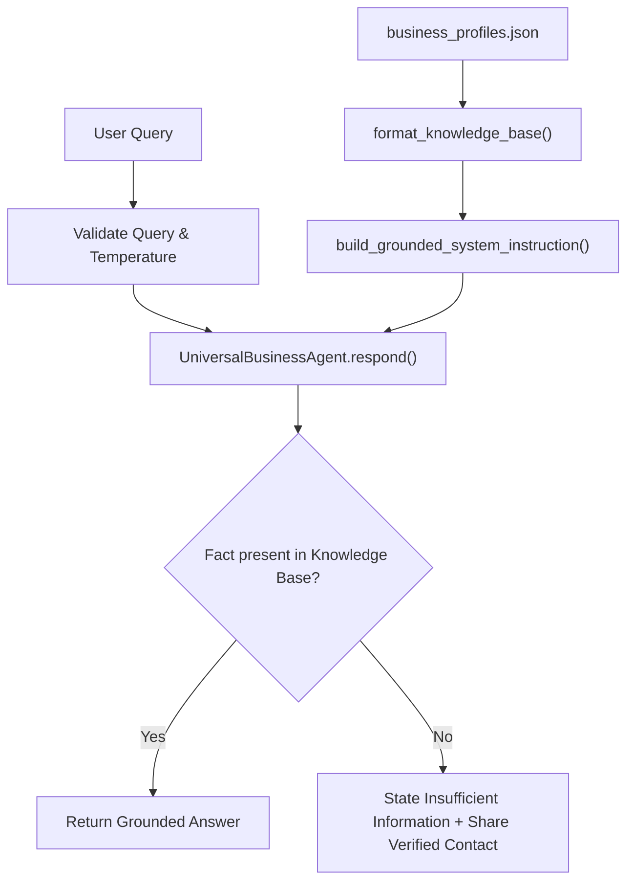
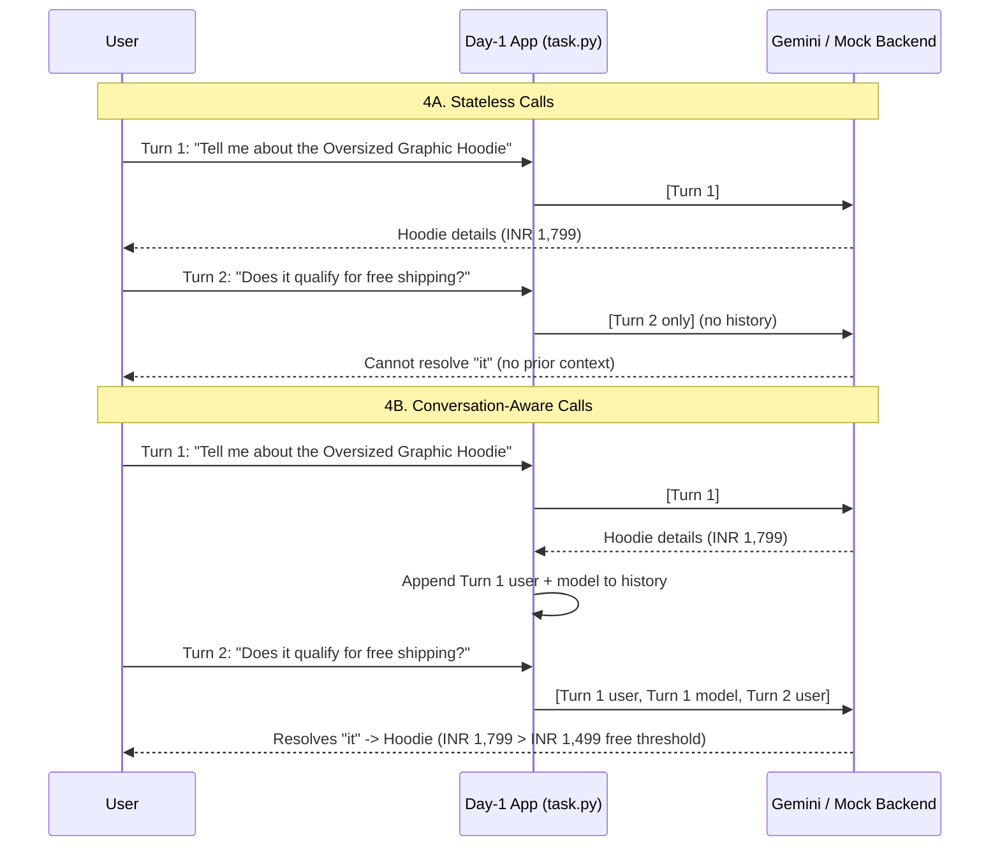
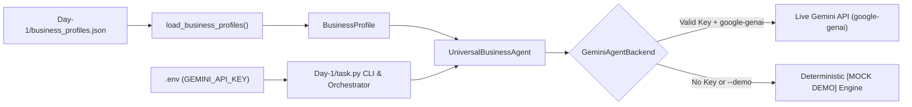

# Day 1: LLM Foundations, Prompt Engineering, Grounding & Configurable Business Context

> **Project:** Universal Business AI Agent | **Organization:** SAI Labs (Sainadh Advanced Intelligence Labs)  
> **Program:** Drive Ready – AI Agents | One Person Company (OPC) Initiative (Academic Year 2026)  
> **Repository:** `24P31A4232_DriveReady_OPC_2026`

---

## 1. Day 1 Objective

Build the reusable foundation of the **Universal Business AI Agent**—a single Python agent core capable of serving multiple businesses across completely different industries (starting with **Dripzoid** for E-commerce/Fashion and **EduSmart** for Education/EdTech) strictly through external JSON configuration and grounded business knowledge, without rewriting the underlying agent code.

Day 1 establishes:
- Direct integration with the current official Google GenAI Python SDK (`google-genai`).
- Deterministic `[MOCK DEMO]` execution when no `GEMINI_API_KEY` is configured so every task runs offline and safely.
- Strict grounding guardrails, stateless vs. conversation-aware invocation patterns, and transparent token-usage reporting.

---

## 2. Learning Outcomes

By completing Day 1, you understand and implement:
1. **LLM Mechanics & Sampling**: How next-token prediction behaves under vague vs. structured prompts, low (`0.0`) vs. high (`0.9`) temperatures, and system vs. user roles.
2. **Parameterized Prompt Engineering**: Designing a validated prompt template separating reusable behavioral rules from business-specific identity (`business_name`, `industry`, `description`, `tone`, `user_query`).
3. **Knowledge Grounding & Hallucination Prevention**: Injecting verified local JSON business facts into `system_instruction` and instructing the agent to refuse guessing when information is missing.
4. **Application-Managed Memory**: Demonstrating why LLM APIs are stateless by default and why the host application must manage and pass conversation turns explicitly.
5. **Token Economics & Context Limits**: Distinguishing rough local character/word estimates from authoritative `usage_metadata` returned by the Gemini API.
6. **Configuration-Driven Multi-Tenant Architecture**: Switching the same `UniversalBusinessAgent` between Dripzoid, EduSmart, or any custom domain JSON profile at runtime.

---

## 3. Explanation of LLM Fundamentals

A **Large Language Model (LLM)** is a neural network trained to predict the probability distribution over the next token given a sequence of preceding tokens (the context window). Because generation is conditioned on everything inside that context window:

- **Prompt Specificity**: Vague prompts leave format, length, and constraints underspecified, producing broad answers. Structured prompts with explicit formatting constraints yield predictable, actionable responses.
- **Temperature (`0.0` to `2.0`)**: Controls randomness during token sampling:
  - **Low temperature (`0.0`–`0.2`)**: Favors high-probability tokens, yielding deterministic, factual, consistent outputs—ideal for customer support and policy Q&A.
  - **High temperature (`0.7`–`1.0+`)**: Flattens the probability distribution, increasing lexical variety and creativity—useful for taglines and brainstorming, risky for factual policy answers.
- **System Instructions vs. User Prompts**:
  - `system_instruction` defines persistent identity, tone, grounding rules, and safety boundaries.
  - `user` prompt carries the immediate end-user request. Separating them prevents business rules from getting mixed with raw customer text.

---

## 4. Prompt Engineering Concepts

Day 1 implements `build_business_prompt_template(...)` in [task.py](file:///c:/Users/yuvat/Downloads/24P31A4232_DriveReady_OPC_2026/Day-1/task.py), which validates and combines five inputs:

| Parameter | Purpose | Example (`dripzoid`) |
|---|---|---|
| `business_name` | Brand identity | `Dripzoid` |
| `business_industry` | Domain framing | `E-commerce / Fashion` |
| `business_description` | Scope of business | `Online clothing shopping platform...` |
| `business_tone` | Voice and style | `Friendly, stylish, clear, and helpful...` |
| `user_query` | Customer request | `What is your return policy?` |

All string inputs are validated via `validate_non_empty_text(...)` before rendering so blank or invalid fields fail early with clear `ValidationError` messages.

---

## 5. Grounding and Hallucination Prevention

General-purpose LLMs frequently "hallucinate" plausible-sounding store policies, shipping speeds, or pricing when they do not know a business's actual rules. To prevent this:

1. `format_knowledge_base(profile)` serializes verified catalog items, official policies, support hours, and contact info from [business_profiles.json](file:///c:/Users/yuvat/Downloads/24P31A4232_DriveReady_OPC_2026/Day-1/business_profiles.json).
2. `build_grounded_system_instruction(profile)` embeds that verified knowledge block inside a **Strict Grounding Constraint** instructing the model to prioritize the supplied facts and never invent unsupported guarantees, delivery speeds, or prices.
3. When asked an unsupported question (for example, *"Do you offer 30-minute drone delivery and a lifetime warranty on hoodies?"*), the agent explicitly states that it does not have enough information in the provided knowledge base.



---

## 6. Stateless vs. Conversation-Aware Interactions

LLM HTTP APIs do **not** retain server-side memory across independent `generate_content` calls. Every call sees only the `contents` array sent in that request:

- **`query_stateless(agent, user_query)`**: Sends only the current `user_query`. Follow-up pronouns like *"Does it qualify for free standard shipping?"* fail because Turn 1 is absent.
- **`query_with_history(agent, user_query, history)`**: Prepends previous `ConversationTurn(role, text)` messages to `contents` and returns the updated history list, allowing the agent to resolve *"it"* to the previously discussed hoodie or bootcamp.



---

## 7. Token Usage and Cost Awareness

Every request consumes tokens across:
1. **Input tokens**: `system_instruction` + serialized knowledge base + conversation `history` + current `user_query`.
2. **Output tokens**: Generated response text (and `thoughts_token_count` if thinking is active on Gemini 2.5 models).

In [task.py](file:///c:/Users/yuvat/Downloads/24P31A4232_DriveReady_OPC_2026/Day-1/task.py), `TokenMetrics` and `format_token_report(...)` strictly separate:
- **Local Estimates (`ESTIMATED`)**: Character count, word count, and `~chars / 4` rough token estimate.
- **API-Reported Usage (`ACTUAL`)**: `prompt_token_count`, `candidates_token_count`, and `total_token_count` read from `response.usage_metadata` during live calls. In `[MOCK DEMO]` mode, API usage is explicitly marked unavailable rather than fabricated.

**Why it matters:**
- **Cost**: Repeating a large knowledge base and long unpruned conversation history on every turn multiplies input token billing.
- **Context Limits & Latency**: Exceeding the model's context window truncates or fails requests, and larger prompts increase response latency.

---

## 8. Business Profile Configuration

Businesses are defined declaratively in [business_profiles.json](file:///c:/Users/yuvat/Downloads/24P31A4232_DriveReady_OPC_2026/Day-1/business_profiles.json). Two profiles are included out of the box:

- **`dripzoid`** — *E-commerce / Fashion* (Online clothing shopping: hoodies, tees, cargo trousers, shipping, returns, order tracking, payments).
- **`edusmart`** — *Education / EdTech* (Online learning academy: Python & AI Agent Foundations Bootcamp, Full-Stack Web Development Track, Data Analytics, enrollment, refunds, certification, recordings).

An additional domain example ([healthcare_profile_example.json](file:///c:/Users/yuvat/Downloads/24P31A4232_DriveReady_OPC_2026/Day-1/examples/healthcare_profile_example.json)) demonstrates adding **Sunrise Family Clinic** without modifying a single line of Python code.

---

## 9. Project Architecture



### Folder Contents

```text
Day-1/
├── README.md
├── task.py
├── business_profiles.json
├── test_day1.py
└── examples/
    ├── demo_walkthrough_output.txt
    ├── healthcare_profile_example.json
    └── sample_queries.json
```

### SDK Modernization Note (`google-generativeai` -> `google-genai`)

The starter root [requirements.txt](file:///c:/Users/yuvat/Downloads/24P31A4232_DriveReady_OPC_2026/requirements.txt) previously listed `google-generativeai>=0.8.0`, which is the legacy Gemini Python SDK. It has been updated to **`google-genai>=1.0.0`** (`from google import genai` and `from google.genai import types`), using `genai.Client(api_key=...)`, `client.models.generate_content(...)`, `types.GenerateContentConfig(system_instruction=..., temperature=...)`, and `response.usage_metadata`.

---

## 10. Installation and Execution Instructions

### Prerequisites
- Python 3.10+
- Virtual environment (recommended)

### Setup
From the repository root:

```bash
pip install -r requirements.txt
```

For **live Gemini API** execution, copy `.env.example` to `.env` in the repository root and set your real API key:

```env
GEMINI_API_KEY=your_actual_gemini_api_key
```

> **Security:** `.gitignore` excludes `.env`. Never commit real API keys.

### Running Day 1

Run inside `Day-1/` (or pass `Day-1/task.py` from the root):

```bash
# Run all 6 tasks (uses Live Gemini API if GEMINI_API_KEY is set, otherwise [MOCK DEMO] mode)
python task.py

# Force offline Demo Mode explicitly (no API key required)
python task.py --demo

# Require Live Gemini API mode (fails cleanly if key or SDK is missing)
python task.py --live

# Run a single task (1-6) with a specific profile
python task.py --demo --task 3 --profile edusmart

# Ask a single grounded question
python task.py --demo --profile dripzoid --query "What is your return policy?"

# Run interactive conversation-aware chat (supports /switch, /profiles, /reset, /exit)
python task.py --demo --interactive

# Test an external business profile JSON without changing code
python task.py --demo --profiles-file examples/healthcare_profile_example.json --query "What is the consultation fee and emergency policy?"

# Run automated unit and integration checks
python -m unittest discover -s . -p "test_*.py" -v
```

*(Note: On Windows systems where the `python` alias points to the Microsoft Store stub, use `py` or the full Python interpreter path.)*

---

## 11. Sample Inputs and Outputs

All outputs below were captured directly from running `python task.py --demo` (stored in [demo_walkthrough_output.txt](file:///c:/Users/yuvat/Downloads/24P31A4232_DriveReady_OPC_2026/Day-1/examples/demo_walkthrough_output.txt)):

### Task 3: Grounding & Hallucination Prevention (`dripzoid`)
- **Supported Query:** `How long does standard delivery take, and what is your return policy?`
  ```text
  [MOCK DEMO | Dripzoid] Verified business information:
  - Shipping And Delivery: Standard delivery takes 3-5 business days across India. Express delivery takes 1-2 business days in metro cities for an extra INR 149. Orders above INR 1,499 qualify for free standard shipping.
  - Returns And Exchanges: Unworn items with original tags can be returned or exchanged within 7 days of delivery. Customized or clearance items are final sale.
  ```
- **Unsupported Query:** `Do you offer 30-minute drone delivery and a lifetime warranty on hoodies?`
  ```text
  [MOCK DEMO | Dripzoid] I do not have enough information in the provided Dripzoid knowledge base to confirm that. I cannot guess or invent unsupported policies, pricing, or timelines. Please contact support@dripzoid.example.com.
  ```

### Task 4: Stateless vs. Conversation-Aware (`dripzoid`)
- **Stateless Turn 2 (`Does it qualify for free standard shipping?`):**
  ```text
  [MOCK DEMO | Dripzoid | Stateless] I do not have previous conversation context, so I cannot tell what item or topic you are referring to. Could you please specify the exact product, course, or policy?
  ```
- **Conversation-Aware Turn 2 (after Turn 1 about the Hoodie):**
  ```text
  [MOCK DEMO | Dripzoid] Here are the verified details:
  - item: Dripzoid Oversized Graphic Hoodie; category: Hoodies & Sweatshirts; price: INR 1,799; sizes: S, M, L, XL; stock status: In stock
  - Shipping And Delivery: Standard delivery takes 3-5 business days across India. Express delivery takes 1-2 business days in metro cities for an extra INR 149. Orders above INR 1,499 qualify for free standard shipping.
  ```

### Task 5: Token Usage Report (Demo Mode)
```text
[Short Stateless Query | Model: gemini-2.5-flash (MOCK DEMO)]
  - Input length (ESTIMATED): 2675 chars, 384 words, ~669 tokens
  - Response length (ESTIMATED): 120 chars, 17 words, ~30 tokens
  - API usage_metadata (ACTUAL): Unavailable in mock/demo mode (no live API call made; not fabricated)
```

### Task 6: Profile Switching (`dripzoid` -> `edusmart`)
- **Dripzoid (`E-commerce / Fashion`):** Returns featured clothing items and the 7-day unworn return/exchange policy.
- **EduSmart (`Education / EdTech`):** Using the exact same `UniversalBusinessAgent` class, returns courses (e.g., *Python & AI Agent Foundations Bootcamp*) and the 7-day / <20% access refund policy.

---

## 12. Common Errors and Troubleshooting

| Symptom / Error | Cause | Fix |
|---|---|---|
| Automatically runs in `[MOCK DEMO]` mode | `GEMINI_API_KEY` is unset or still `your_api_key_here` | Copy `.env.example` to `.env` and paste a valid Gemini API key, or pass `--demo` intentionally. |
| `Live mode requested, but GEMINI_API_KEY is missing...` | Ran `--live` without an exported key | Configure `GEMINI_API_KEY` in `.env` or environment variables. |
| `The 'google-genai' package is not installed` | `google-genai` not installed in active Python environment | Run `pip install -r requirements.txt` inside your virtual environment. |
| `Unknown profile '<name>'` | Profile ID not in `business_profiles.json` | Check available keys (`dripzoid`, `edusmart`) or pass `--profiles-file`. |
| `Malformed JSON in business profiles file` | Syntax error in JSON config | Validate JSON formatting (commas, quotes, braces). |
| `'temperature' must be between 0.0 and 2.0` | Invalid `--temperature` argument | Supply a numeric temperature between `0.0` and `2.0`. |
| Windows `python.exe` access error | Windows Store App Execution Alias intercepts `python` | Run with `py task.py` or your venv's `.venv\Scripts\python.exe`. |

---

## 13. Day 1 Completion Checklist

- [x] Updated deprecated `google-generativeai` dependency in root `requirements.txt` to `google-genai>=1.0.0`.
- [x] Implemented Task 1 (LLM fundamentals, prompt specificity, temperature comparison, system vs. user instructions).
- [x] Implemented Task 2 (validated reusable business prompt template).
- [x] Implemented Task 3 (local JSON knowledge grounding + explicit refusal on unsupported queries).
- [x] Implemented Task 4 (separate `query_stateless` and `query_with_history` functions).
- [x] Implemented Task 5 (length metrics, clear separation of local estimates vs. `usage_metadata`, cost/context explanation).
- [x] Implemented Task 6 (`business_profiles.json` with `dripzoid` and `edusmart` + single reusable `UniversalBusinessAgent`).
- [x] Added offline `[MOCK DEMO]` mode and input/config validation + error handling.
- [x] Added sample queries, extra healthcare profile example, captured walkthrough output, and unit/integration tests.
- [x] Completed Day 1 syntax checks and test verification in demo mode (live Gemini API calls not executed because no `GEMINI_API_KEY` is configured in this workspace).
