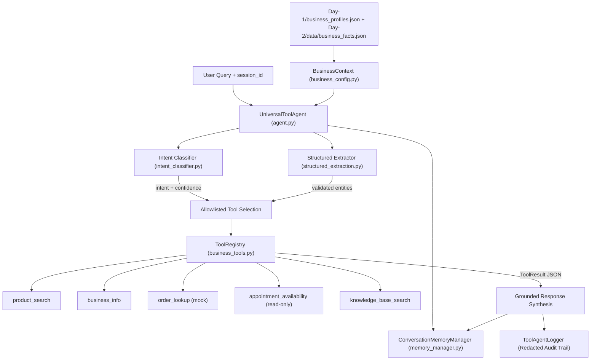
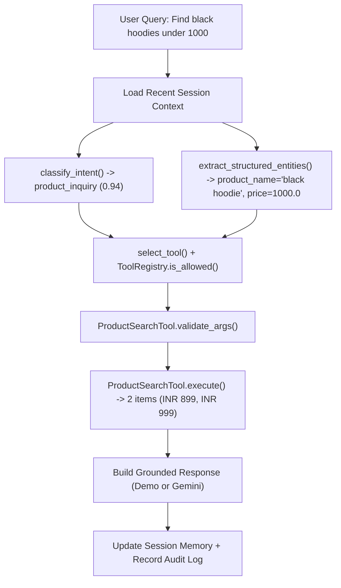
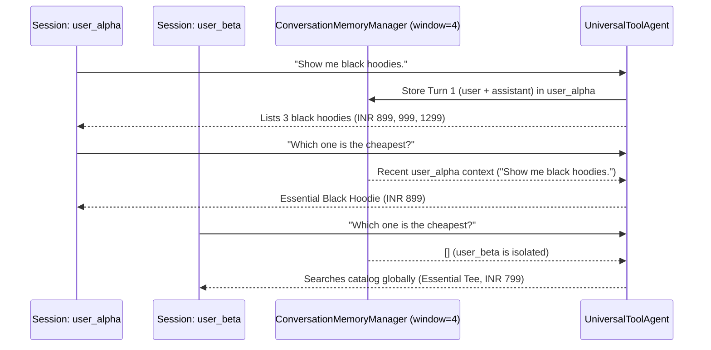

# Day 2: Structured Outputs, Business Tool Calling, Memory & Audit Logging

> **Universal Business AI Agent** | SAI Labs (Sainadh Advanced Intelligence Labs)
>
> **Program:** Drive Ready – AI Agents | One Person Company (OPC) Initiative (Academic Year 2026)
>
> **Repository:** `24P31A4232_DriveReady_OPC_2026` | **Developer:** K. Yuvateja Sainadh

---

## 1. Day 2 Objectives

Day 2 upgrades the Day 1 grounded prompt assistant into an **action-capable, tool-using business agent** while preserving the same reusable core across industries:

1. Classify customer messages into structured business intents with confidence scores.
2. Extract validated structured entities (order IDs, prices, product names, dates, contact info) without inventing missing fields.
3. Execute safe, allowlisted business tools (`product_search`, `business_info`, `order_lookup`, `appointment_availability`, `knowledge_base_search`).
4. Route queries cleanly through an explicit tool selection pipeline and synthesize grounded responses.
5. Maintain bounded, session-isolated conversational memory (`ConversationMemoryManager`).
6. Load operational facts (`business_facts.json`) alongside Day 1 profiles (`Day-1/business_profiles.json`) at runtime.
7. Record sanitized structured execution logs and run automated evaluation checks.

---

## 2. Concepts Covered (Beginner-Friendly Guide)

- **Intent Classification**: Instead of letting an LLM guess what to do freehand, we first ask: *"What kind of request is this?"* (for example, `order_status` vs. `product_inquiry` vs. `unknown`).
- **Structured Extraction**: Pulls clean key-value fields (`order_id="DZ1024"`, `price=1000.0`) out of messy natural language so Python functions can validate and use them reliably.
- **Tool Calling & Allowlists**: LLMs should never run arbitrary code or invent live order statuses. Instead, the agent chooses from an approved **Tool Registry**—a strict allowlist of Python tools that validate arguments and return deterministic JSON results.
- **Bounded Session Memory**: Remembers only the last *N* messages per user session (`window_size`) so follow-up questions like *"Which one is the cheapest?"* work without overflowing context limits or leaking another user's chat.

---

## 3. Project Architecture

Day 2 reuses Day 1's `google-genai` backend (`GeminiAgentBackend`), `BusinessProfile` loader, and validation exceptions via [business_config.py](file:///c:/Users/yuvat/Downloads/24P31A4232_DriveReady_OPC_2026/Day-2/business_config.py), without duplicating Day 1 code.



### Folder Structure

```text
Day-2/
├── README.md
├── task.py
├── business_config.py
├── business_tools.py
├── intent_classifier.py
├── structured_extraction.py
├── memory_manager.py
├── agent.py
├── test_day2.py
├── examples/
│   ├── sample_queries.json
│   ├── expected_intents.json
│   └── demo_walkthrough_output.txt
└── data/
    └── business_facts.json
```

---

## 4. Intent Classification (`intent_classifier.py`)

`classify_intent(...)` supports 12 configurable business intents:

`product_inquiry`, `order_status`, `pricing_inquiry`, `refund_request`, `cancellation_request`, `appointment_booking`, `course_information`, `business_hours`, `contact_information`, `complaint`, `general_inquiry`, `unknown`.

- **Live Mode**: Prompts Gemini (`google-genai`) to return strict JSON constrained to the active business's allowed intents.
- **Demo Mode**: Deterministic keyword/pattern classifier returning structured `IntentResult` JSON.
- **Safety**: Classifying an intent **never** triggers a refund, cancellation, or database mutation. Ambiguous inputs such as `"xyz123???"` return `intent: "unknown"` and `requires_clarification: true`.

---

## 5. Structured Information Extraction (`structured_extraction.py`)

`extract_structured_entities(...)` normalizes up to 12 fields (`customer_name`, `email`, `phone_number`, `order_id`, `product_name`, `product_category`, `price`, `date`, `appointment_time`, `course_name`, `location`, `requested_action`) into an `ExtractedEntities` dataclass:

- Uppercases and validates `order_id` (e.g., `dz1024` -> `DZ1024`).
- Parses numeric INR price filters (e.g., `"under 1000"` -> `1000.0`).
- Distinguishes ISO dates (`2026-11-28`) from phone numbers.
- Leaves unmentioned fields as `None`—never fabricating customer names, emails, or order IDs.

---

## 6. Tool Calling & Tool Registry (`business_tools.py`)

Every tool inherits from `BusinessTool` (`validate_args` + `execute`) and is registered inside `ToolRegistry`:

| Tool Name | Purpose | Required Args | Safety Guardrail |
|---|---|---|---|
| `product_search` | Filter catalog by query, category, max price, and sort order | None | Read-only catalog search |
| `business_info` | Return support hours, contact, services, and policies | None | Read-only profile data |
| `order_lookup` | Look up sample orders (`DZ1024`, `ES2041`) | `order_id` | Rejects blank IDs; returns `not_found` for unknown IDs; mock-labeled |
| `appointment_availability` | Preview available consultation/counseling slots | None | Read-only (`booking_performed: false`) |
| `knowledge_base_search` | Search business FAQs, policies, and services | `query` | Rejects empty queries; grounded only |

Unregistered tool names (e.g., `"run_shell"`) raise `ToolRegistryError` immediately.

---

## 7. Agent Workflow (`agent.py`)



---

## 8. Conversational Memory (`memory_manager.py`)

`ConversationMemoryManager` provides volatile, in-memory session storage:

- **Configurable Sliding Window**: `window_size=6` keeps only the latest 6 messages (`window_size=0` enables stateless mode).
- **Session Isolation**: Session `alice` and session `bob` live under isolated keys; `bob` never sees `alice`'s prior hoodie query.
- **Debug & Control**: `inspect_session(session_id)` and `clear_session(session_id)`.
- **Volatile vs. Persistent**: Explicitly tagged `volatile_in_memory_session_store`; data resets when the process exits (unlike persistent databases).



---

## 9. Business Configuration (`data/business_facts.json`)

[business_facts.json](file:///c:/Users/yuvat/Downloads/24P31A4232_DriveReady_OPC_2026/Day-2/data/business_facts.json) extends Day 1's [business_profiles.json](file:///c:/Users/yuvat/Downloads/24P31A4232_DriveReady_OPC_2026/Day-1/business_profiles.json) with supplementary catalog items, FAQs, mock orders (`DZ1024`, `DZ1025`, `ES2041`), appointment slots, and allowed intents. Switching between **Dripzoid** and **EduSmart** uses `agent.switch_business(new_context)` with zero code changes.

---

## 10. Structured Logging & Evaluation (`agent.py`)

`ToolAgentLogger` records `user_query`, `selected_business`, `predicted_intent`, `confidence`, `extracted_entities`, `selected_tool`, `tool_arguments`, `tool_result`, `execution_status`, and `execution_duration_ms`, while redacting credential-like strings (`AIza...`, `Bearer ...`, `api_key`, `password`).

`evaluate_agent_cases(...)` evaluates intent accuracy, tool selection accuracy, and entity extraction accuracy against [expected_intents.json](file:///c:/Users/yuvat/Downloads/24P31A4232_DriveReady_OPC_2026/Day-2/examples/expected_intents.json).

---

## 11. Demo Execution & Live Gemini Setup

### Demo Mode (Offline, No API Key Required)

```bash
python Day-2/task.py --demo
python Day-2/task.py --demo --profile dripzoid
python Day-2/task.py --demo --profile edusmart
python Day-2/task.py --demo --query "Find black hoodies under 1000"
python Day-2/task.py --demo --query "Where is my order DZ1024?"
python Day-2/task.py --demo --interactive
python Day-2/task.py --demo --eval
```

### Live Gemini Setup (`google-genai`)

1. Install dependencies from root: `pip install -r requirements.txt` (uses `google-genai>=1.0.0`, not the deprecated `google-generativeai` package).
2. Add your real key to `.env` in the repo root (`GEMINI_API_KEY=...`).
3. Run:

```bash
python Day-2/task.py --live --profile dripzoid
```

---

## 12. Testing Instructions

Run syntax checks, the 17-case unit/integration test suite, and the full demo walkthrough:

```bash
# Bash / Linux / macOS
python -m py_compile Day-2/*.py
python -m unittest discover -s Day-2 -p "test_*.py" -v
python Day-2/task.py --demo
```

On Windows PowerShell (which does not expand `*.py` globs for native executables):

```powershell
py -m py_compile (Get-ChildItem Day-2\*.py).FullName
py -m unittest discover -s Day-2 -p "test_*.py" -v
py Day-2/task.py --demo
```

---

## 13. Example Inputs and Outputs

Captured directly from `Day-2/task.py --demo` (full log in [demo_walkthrough_output.txt](file:///c:/Users/yuvat/Downloads/24P31A4232_DriveReady_OPC_2026/Day-2/examples/demo_walkthrough_output.txt)):

### Intent Classification (`Where is my order DZ1024?`)
```json
{
  "intent": "order_status",
  "confidence": 0.96,
  "entities": {
    "order_id": "DZ1024",
    "requested_action": "check_delivery_status"
  },
  "requires_clarification": false
}
```

### Tool-Calling Workflow (`Find black hoodies under 1000`)
```text
User: Find black hoodies under 1000
-> Intent: product_inquiry (conf=0.94) | Tool: product_search | Status: success
Agent:
[MOCK DEMO | Dripzoid] Found 2 matching item(s) in Dripzoid:
- item: Dripzoid Essential Black Hoodie; category: Hoodies & Sweatshirts; color: Black; price: INR 899; sizes: S, M, L, XL; stock_status: In stock
- item: Dripzoid Midnight Black Zip Hoodie; category: Hoodies & Sweatshirts; color: Black; price: INR 999; sizes: M, L, XL; stock_status: In stock
```

### Evaluation Summary (Offline Demo Mode)
```text
Evaluation Summary:
  Total Cases: 8 | Intent Accuracy: 1.00 | Tool Selection Accuracy: 1.00 | Entity Accuracy: 1.00
```

---

## 14. Known Limitations & Next Steps for Day 3

- **Mock Order & Appointment Data**: Order lookup and appointment slots read from static JSON in `data/business_facts.json`; no live database or booking writes occur.
- **In-Memory Session Store**: Conversation memory is cleared when the CLI exits.
- **Live Gemini Execution**: Live API prompts are implemented via Day 1's `google-genai` backend, but require a valid `GEMINI_API_KEY` to test at runtime.
- **Day 3 Direction**: Introduce LangChain / LCEL orchestration pipelines, persistent evaluation harnesses over `Day-3/test.csv`, automated regression scoring, and production architecture hardening.
