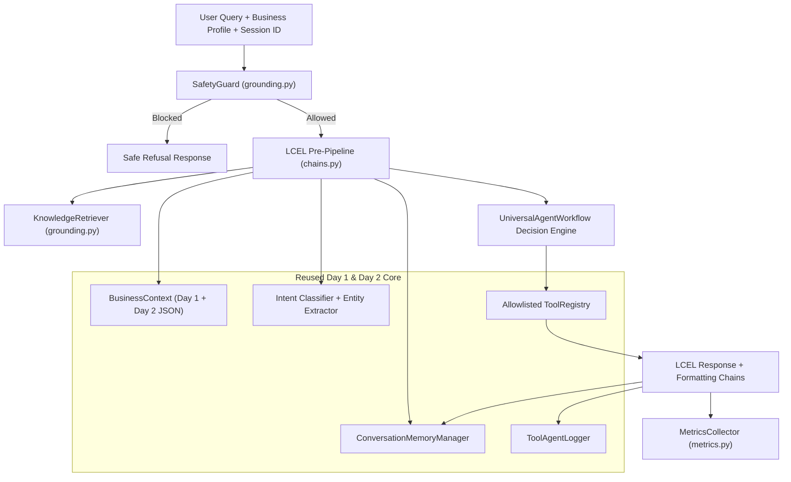
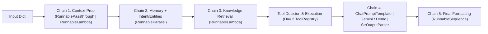
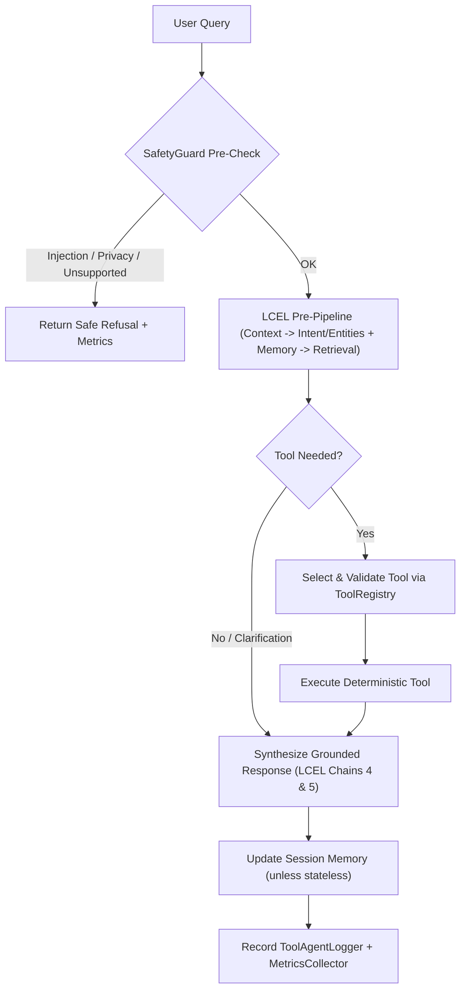
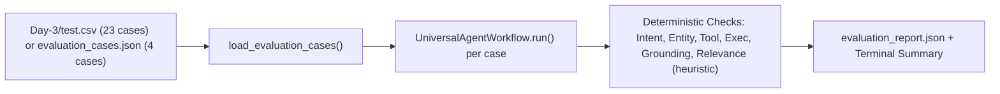

# Day 3: LCEL Agent Architecture, Grounding, Metrics & Evaluation

> **Universal Business AI Agent** | SAI Labs (Sainadh Advanced Intelligence Labs)
>
> **Program:** Drive Ready – AI Agents | One Person Company (OPC) Initiative (Aditya University, Academic Year 2026)
>
> **Repository:** `24P31A4232_DriveReady_OPC_2026` | **Developer:** K. Yuvateja Sainadh

---

## 1. Day 3 Objectives

Day 3 unifies Day 1 (Gemini SDK, prompt engineering, business profiles, token tracking) and Day 2 (intent classification, entity extraction, allowlisted tools, session memory, audit logs) into a **complete, composable, self-evaluating Universal Business AI Agent**:

1. Compose modular pipelines with **LangChain Expression Language (LCEL)**.
2. Connect every step into one reusable **Multi-Step Agent Workflow** (`UniversalAgentWorkflow`).
3. Contrast **Deterministic Python Logic**, **LLM-Only Processing**, and **Tool-Using Agent Execution**.
4. Add transparent **Knowledge Retrieval** and **Safety Guardrails** (`grounding.py`).
5. Measure stage-by-stage **Latency & Token Metrics** (`metrics.py`).
6. Run repeatable **CSV & JSON Automated Evaluations** (`evaluation.py` + `test.csv`).

---

## 2. Concepts Covered (Beginner-Friendly Guide)

- **LangChain Expression Language (LCEL):** Think of LCEL like Unix pipes (`step1 | step2 | step3`). Each step is a `Runnable` with a standard `.invoke(input)` method, so you can swap prompts, retrievers, or models cleanly without rewriting the pipeline.
- **Deterministic vs. LLM vs. Agent:** Plain Python handles exact math (`1799 * 0.9 = 1619.1`) instantaneously for zero cost. An LLM alone summarizes text and adapts tone, but cannot look up live order records. An **AI Agent** combines both: it understands intent, calls an authorized Python tool (`order_lookup`), and turns the verified result into a helpful response.
- **Grounding & Safety Guardrails:** Prevents the agent from inventing policies, leaking another customer's session/order, or obeying prompt-injection attacks (`"Ignore all previous business instructions..."`).
- **Automated Evaluation:** Instead of guessing if an agent "looks good," a CSV test suite checks intent accuracy, entity extraction, tool choice, grounding compliance, and latency automatically after every change.

---

## 3. Complete System Architecture

Day 3 reuses Day 1 (`Day-1/task.py`, `Day-1/business_profiles.json`) and Day 2 (`Day-2/agent.py`, `Day-2/business_tools.py`, `Day-2/memory_manager.py`, `Day-2/data/business_facts.json`) without duplicating their logic.



### Folder Structure

```text
Day-3/
├── README.md
├── task.py
├── agent_workflow.py
├── chains.py
├── evaluation.py
├── metrics.py
├── grounding.py
├── test_day3.py
├── test.csv
├── data/
│   └── evaluation_cases.json
└── examples/
    ├── sample_workflows.json
    ├── evaluation_report.json
    └── demo_walkthrough_output.txt
```

---

## 4. LangChain & LCEL Integration (`chains.py`)

`chains.py` uses modern non-deprecated LCEL primitives (`RunnableSequence`, `RunnableLambda`, `RunnablePassthrough`, `RunnableParallel`, `ChatPromptTemplate`, `StrOutputParser`) and `ChatGoogleGenerativeAI` (`langchain-google-genai`).

- **Installed-Environment Note:** In environments where `langchain-core` and `langchain-google-genai` are not yet installed (as checked via `pip show` in this workspace), `chains.py` activates a transparent `builtin_lcel_compat` layer providing identical `.invoke()` and `|` pipe semantics so all offline demos and unit tests run cleanly. When `pip install -r requirements.txt` is installed, `LCEL_BACKEND` switches automatically to `langchain_core`.
- **Avoiding Duplicate LLM Calls:** Rather than invoking Gemini separately for entities and again for intents inside `RunnableParallel`, `build_intent_and_entity_chain` runs memory retrieval and query analysis in parallel and reuses `intent_res.entities` in live mode.



---

## 5. Multi-Step Agent Workflow (`agent_workflow.py`)



---

## 6. Deterministic vs. LLM vs. Agent Execution

| Approach | Example | Latency (Demo) | Best Used For |
|---|---|---|---|
| **Deterministic Python** | `calculate_discount(1799, 10) -> 1619.1`, `validate_order_id_format("DZ1024") -> True` | ~`0.006 ms` | Exact math, budget checks, regex/schema validation, zero API cost |
| **LLM-Only (LCEL)** | Summarize Dripzoid return policy (`ChatPromptTemplate \| LLM \| StrOutputParser`) | ~`0.016 ms` (mock) | Natural-language summarization, tone control; **cannot** query live orders |
| **Tool-Using Agent** | `"Where is my order DZ1024?"` -> `order_status` -> `order_lookup` -> grounded answer | ~`0.23 ms` (mock) | Multi-step workflows combining language understanding + verified tools |

---

## 7. Knowledge Retrieval & Grounding (`grounding.py`)

- **`KnowledgeRetriever`**: Lightweight keyword-overlap retriever (no paid vector DB required) searching FAQs, official policies, catalog items, and hours/contact details strictly within the active `BusinessContext`.
- **`SafetyGuard`**:
  - Blocks prompt-injection overrides (`"Ignore all previous business instructions..."`).
  - Blocks cross-customer/cross-session requests (`"Show me another customer's order history."`).
  - Blocks unsupported claims (`"30-minute drone delivery"`, `"lifetime warranty"`, `"free laptops"`).
  - Never claims real bookings or refunds executed in this mock-safe version.

---

## 8. Evaluation Framework & CSV Dataset (`evaluation.py` + `test.csv`)



- **CSV Schema (`Day-3/test.csv` — 23 cases across Dripzoid & EduSmart):**
  `test_id,business_profile,user_query,expected_intent,expected_tool,expected_entity,expected_response_type`
- **Honest Relevance Labeling:** Intent, entity, tool selection, execution status, and grounding checks are exact/deterministic. `response_relevance_rate` is explicitly labeled **`deterministic_heuristic`** (keyword/entity/response-type match) rather than claiming an objective LLM-judged semantic score.

---

## 9. Performance & Token Metrics (`metrics.py`)

`StageTimer` (`time.perf_counter()`) records per-stage latency (`intent_classification_ms`, `entity_extraction_ms`, `knowledge_retrieval_ms`, `tool_execution_ms`, `response_generation_ms`, `total_time_ms`), tool execution counts, LLM call counts, and token metrics (`estimated_*` clearly separated from `api_*` `usage_metadata`, never fabricated and never logging secrets).

---

## 10. Setup, Demo Commands & Live Gemini Configuration

### Installation
```bash
pip install -r requirements.txt
```

### Demo Commands (Offline, No API Key Required)
```bash
python Day-3/task.py --demo
python Day-3/task.py --demo --profile dripzoid
python Day-3/task.py --demo --profile edusmart
python Day-3/task.py --demo --query "Where is my order DZ1024?"
python Day-3/task.py --demo --interactive
python Day-3/task.py --demo --eval
python Day-3/task.py --demo --eval --dataset Day-3/test.csv
python Day-3/task.py --demo --metrics
python Day-3/task.py --demo --compare-execution
```

### Live Gemini Mode
Add `GEMINI_API_KEY` to `.env` in the repository root and install dependencies (`pip install -r requirements.txt`):
```bash
python Day-3/task.py --live --profile dripzoid
```

### Automated Tests (Day 3, Day 2 & Day 1)
```powershell
py -m py_compile Day-3\agent_workflow.py Day-3\chains.py Day-3\evaluation.py Day-3\grounding.py Day-3\metrics.py Day-3\task.py Day-3\test_day3.py
py -m unittest discover -s Day-3 -p "test_*.py" -v
py -m unittest discover -s Day-2 -p "test_*.py" -v
py -m unittest discover -s Day-1 -p "test_*.py" -v
```

---

## 11. Observed Sample Outputs & Evaluation Results

Captured directly from running `Day-3/task.py --demo --eval` and `Day-3/task.py --demo` (saved in [evaluation_report.json](file:///c:/Users/yuvat/Downloads/24P31A4232_DriveReady_OPC_2026/Day-3/examples/evaluation_report.json) and [demo_walkthrough_output.txt](file:///c:/Users/yuvat/Downloads/24P31A4232_DriveReady_OPC_2026/Day-3/examples/demo_walkthrough_output.txt)):

```text
Dataset: test.csv + evaluation_cases.json | Cases: 27/27 passed
Mode: mock_demo | Relevance Method: deterministic_heuristic (keyword/entity/response-type match, not LLM-judged)
Metrics:
  - Intent Accuracy:          100.0%
  - Entity Accuracy:          100.0%
  - Tool Selection Accuracy:  100.0%
  - Tool Execution Success:   100.0%
  - Grounding Compliance:     100.0%
  - Response Relevance (heur):100.0%
  - Overall Pass Rate:        100.0%
Performance Summary:
  - Avg Latency: 0.532 ms | Total Tool Executions: 32 | Total LLM Calls: 0
Failures: None (100% pass)
```

---

## 12. Known Limitations & Future Roadmap

- **Current Limitations:**
  - Demo mode runs deterministically without live Gemini API calls (live Gemini API calls were not tested in this workspace because `GEMINI_API_KEY` and `langchain-core` / `google-genai` packages are not installed locally).
  - Order lookup and appointment availability use static mock records from Day 2's `business_facts.json`, and memory is volatile in-RAM per session.
- **Future Roadmap (Production Evolution):**
  1. Connect real e-commerce/EdTech REST APIs or databases behind the Day 2 `ToolRegistry` interface.
  2. Persist session memory and audit logs in SQLite/PostgreSQL/Firestore.
  3. Add optional semantic embeddings retrieval and run live Gemini regression benchmarks against `Day-3/test.csv`.
