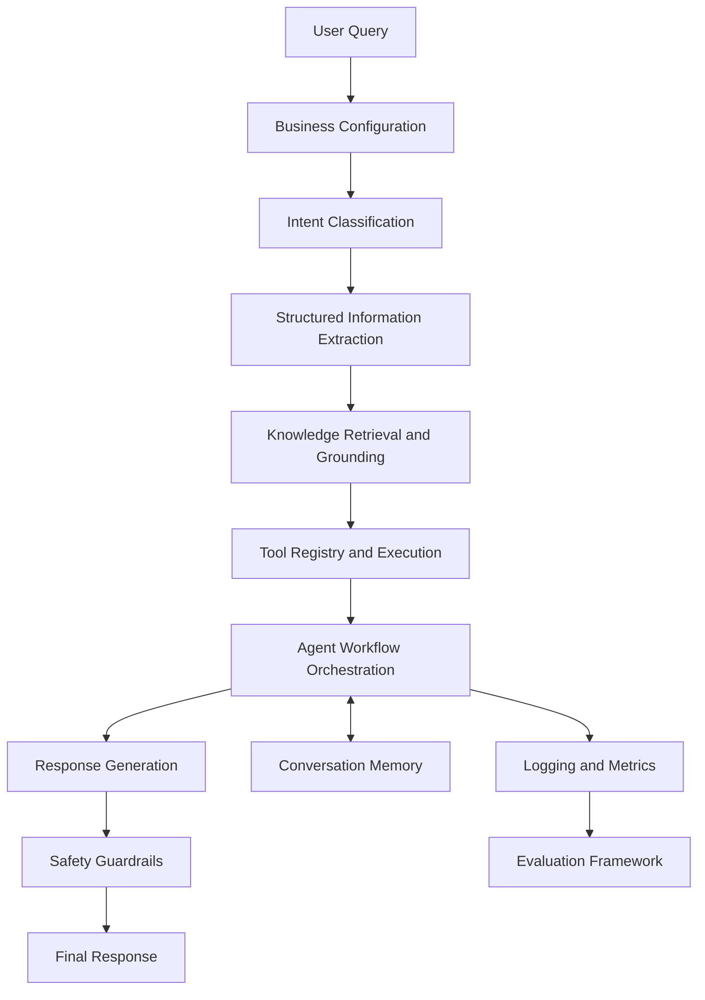

# Universal Business AI Agent | Drive Ready – OPC 2026

> **Department of Technical Training, Aditya University**  
> **Roll Number:** 24P31A4232  
> **Developed under:** SAI Labs – Sainadh Advanced Intelligence Labs

## Project Overview

The **Universal Business AI Agent** is a reusable, configurable AI agent framework designed to support businesses across multiple industries through a common intelligent architecture.

Developed under **SAI Labs**, this project explores how a single AI agent infrastructure can be adapted to different organizations using business-specific configurations, knowledge sources, tools, instructions, and permissions.

Instead of building a separate AI assistant from scratch for every organization, the framework provides a shared foundation for:

- Customer interaction and conversational assistance
- Business information retrieval and knowledge grounding
- Intent classification and structured data extraction
- Tool and function execution
- Conversation memory and context management
- Multi-step agent workflows
- Safety guardrails and fallback responses
- Automated testing, evaluation, and performance metrics

## Core Vision

**One AI Infrastructure. Every Business.**

The goal is to create a universal agent architecture that can be configured for different business domains without rebuilding its core intelligence and workflow infrastructure.

## Architecture Overview

The project follows a modular, multi-layer architecture.



### Main Components

| Component | Responsibility |
|---|---|
| Business Configuration | Loads business-specific identity, instructions, and settings |
| Intent Classifier | Identifies user intent and classification confidence |
| Structured Extraction | Extracts and normalizes relevant entities from user queries |
| Knowledge Retrieval | Retrieves business-specific information for grounded responses |
| Tool Registry | Registers, validates, and executes permitted business tools |
| Memory Manager | Maintains bounded, session-isolated conversation context |
| Agent Workflow | Coordinates multiple stages of agent execution |
| Safety Guardrails | Handles unsafe requests, unsupported claims, and cross-business access |
| Evaluation Framework | Measures workflow correctness and evaluation metrics |
| Logging and Metrics | Records execution details, timings, and token usage information |

## Implemented Features

### Day 1 – LLM Foundations and Business Context

Implemented foundational LLM interaction and configurable business context.

- Gemini API integration using the modern `google-genai` SDK.
- Configurable business profiles.
- Prompt templates and system instructions.
- Temperature configuration.
- Business knowledge grounding.
- Stateless and conversational interaction examples.
- Token usage handling.
- Reusable `UniversalBusinessAgent`.
- Command-line execution and demonstration modes.
- Support for switching between business profiles.

### Day 2 – Structured Outputs, Tools and Memory

Implemented an extensible tool-enabled agent architecture.

- Configurable intent classification covering 12 intent categories.
- Intent confidence handling.
- Structured information extraction across 12 entity fields.
- Entity normalization and missing-value handling.
- Centralized tool registry.
- Tool argument validation and controlled execution.
- Five business tools:
  - Product Search
  - Business Information
  - Order Lookup
  - Appointment Availability
  - Knowledge Base Search
- Session-isolated conversation memory.
- Bounded sliding-window memory.
- Stateless execution and memory clearing.
- Structured tool logging with credential redaction.
- Evaluation support and deterministic demonstration mode.

### Day 3 – Agent Architecture and Evaluation

Implemented a multi-step agent workflow with reusable chain components and automated evaluation.

- Reusable LangChain Expression Language (LCEL) chain architecture.
- RunnableSequence, RunnableLambda, RunnablePassthrough, and RunnableParallel components.
- ChatPromptTemplate and StrOutputParser integration.
- ChatGoogleGenerativeAI integration for supported live execution environments.
- Multi-step `UniversalAgentWorkflow`.
- Integration with Day 2 agent, tools, business context, and memory.
- Comparison of deterministic, LLM-only, and agent-based execution approaches.
- Business-specific knowledge retrieval.
- Grounding and safety validation.
- Prompt-injection and cross-customer access checks.
- Workflow stage timing and token usage metrics.
- CSV and JSON evaluation support.
- Automated evaluation reports and terminal summaries.

**Evaluation dataset:** 23 CSV cases and 4 JSON cases, totaling 27 cases.

## Supported Business Domains

The framework includes configurable business examples and is designed to be extended to other industries.

| Business Profile | Domain | Example Applications |
|---|---|---|
| Dripzoid | E-commerce and Retail | Product discovery, order lookup, store information |
| EduSmart | Education and EdTech | Course discovery, enrollment assistance, institution information |
| Sunrise Family Clinic | Healthcare | Healthcare profile configuration and information assistance |

Additional potential domains include:

- Restaurants and hospitality
- Real estate
- Professional services
- Local businesses
- Retail and manufacturing
- Other configurable business domains

> Business examples are demonstration profiles. Production deployment requires real business data, verified integrations, and domain-appropriate permissions and safeguards.

## Technology Stack

| Technology | Purpose |
|---|---|
| Python 3.10+ | Core development |
| Google Gemini API | LLM interaction |
| `google-genai` | Gemini API SDK |
| LangChain | Agent and chain orchestration |
| LangChain Core | LCEL components |
| LangChain Google GenAI | Gemini integration with LangChain |
| JSON | Business configurations and structured data |
| CSV | Evaluation datasets |
| Python Unittest | Automated testing |

## Repository Structure

```text
24P31A4232_DriveReady_OPC_2026/
│
├── README.md
├── requirements.txt
├── .env.example
├── .gitignore
│
├── Day-1/
│   ├── README.md
│   ├── task.py
│   ├── business_profiles.json
│   ├── test_day1.py
│   └── examples/
│
├── Day-2/
│   ├── README.md
│   ├── task.py
│   ├── agent.py
│   ├── business_config.py
│   ├── intent_classifier.py
│   ├── structured_extraction.py
│   ├── business_tools.py
│   ├── memory_manager.py
│   ├── data/
│   ├── examples/
│   └── test_day2.py
│
└── Day-3/
    ├── README.md
    ├── task.py
    ├── chains.py
    ├── agent_workflow.py
    ├── grounding.py
    ├── metrics.py
    ├── evaluation.py
    ├── test.csv
    ├── test_day3.py
    ├── data/
    └── examples/
```

*The structure above highlights the principal project files; individual folders may contain additional datasets, reports, and supporting examples.*

## Installation and Setup

### 1. Clone the Repository

```bash
git clone https://github.com/yuvatejasainadh/24P31A4232_DriveReady_OPC_2026.git

cd 24P31A4232_DriveReady_OPC_2026
```

### 2. Create a Virtual Environment

```bash
python -m venv venv
```

Activate it:

**Windows:**

```bash
venv\Scripts\activate
```

**Linux / macOS:**

```bash
source venv/bin/activate
```

### 3. Install Dependencies

```bash
pip install -r requirements.txt
```

### 4. Configure Gemini API

Copy `.env.example` to `.env` and configure your API key:

```env
GEMINI_API_KEY=your_api_key_here
GEMINI_MODEL=gemini-2.5-flash
```

Use a valid Gemini API key obtained through Google AI Studio.

> **Security:** Never commit `.env`, API keys, passwords, or other secrets to GitHub.

## Running the Project

Run commands from the repository root.

### Day 1 – LLM Foundations

```bash
python Day-1/task.py --demo
```

Run individual demonstrations:

```bash
python Day-1/task.py --demo --task 3 --profile dripzoid

python Day-1/task.py --demo --task 3 --profile edusmart

python Day-1/task.py --demo --task 4 --profile edusmart
```

Run interactive mode:

```bash
python Day-1/task.py --demo --interactive
```

### Day 2 – Tool-Enabled Agent

```bash
python Day-2/task.py --demo
```

Run the Day 2 walkthrough and other supported demonstrations using the options documented in `Day-2/README.md`.

### Day 3 – Agent Workflow and Evaluation

Run the demonstration:

```bash
python Day-3/task.py --demo
```

Run automated evaluation:

```bash
python Day-3/task.py --eval
```

Run workflow metrics:

```bash
python Day-3/task.py --metrics
```

Run execution comparison:

```bash
python Day-3/task.py --compare
```

For additional supported arguments, refer to `Day-3/README.md`.

## Automated Testing

The project includes day-wise unit tests.

Run all test suites:

```bash
python -m unittest discover -s Day-1 -p "test_*.py" -v

python -m unittest discover -s Day-2 -p "test_*.py" -v

python -m unittest discover -s Day-3 -p "test_*.py" -v
```

### Reported Test Results

| Day | Tests Passed | Result |
|---|---:|---|
| Day 1 | 7/7 | Passed |
| Day 2 | 17/17 | Passed |
| Day 3 | 24/24 | Passed |
| **Total** | **48/48** | **Passed** |

### Day 3 Evaluation Results

| Evaluation Dataset | Cases Passed |
|---|---:|
| CSV evaluation | 23/23 |
| JSON evaluation | 4/4 |
| **Combined** | **27/27** |

The Day 3 deterministic demonstration reported 100% on its implemented evaluation metrics, including intent accuracy, entity accuracy, tool selection, tool execution, grounding compliance, and overall pass rate.

**Evaluation qualification:** These results represent the implemented deterministic demonstration and its evaluation logic. Response relevance uses a heuristic rather than independent semantic assessment. They should not be interpreted as production accuracy or live Gemini performance.

## Current Implementation Status

| Area | Status |
|---|---|
| Day 1 LLM foundations | Implemented |
| Business profile configuration | Implemented |
| Day 2 intent classification | Implemented |
| Structured information extraction | Implemented |
| Tool registry and validation | Implemented |
| Conversation memory | Implemented |
| Day 3 agent workflow | Implemented |
| LCEL chain architecture | Implemented with offline compatibility fallback |
| Knowledge grounding and safety checks | Implemented |
| CSV and JSON evaluation | Implemented |
| Automated unit tests | Implemented |
| Live Gemini integration | Requires environment setup and live validation |
| Persistent production memory | Future enhancement |
| Real business API integrations | Future enhancement |
| Production deployment | Future enhancement |

## Important Technical Notes and Limitations

- The project supports deterministic demonstration modes for development and testing without requiring a live Gemini API call.
- During the reported Day 3 validation, LangChain and Gemini dependencies were not installed in the execution environment. The offline compatibility fallback was used for the reported tests.
- Live Gemini API execution has not yet been validated in that environment.
- Business orders, appointments, and other operational records currently use demonstration data where applicable.
- Conversation memory is currently in-memory and is not persistent across application restarts.
- Evaluation metrics are implementation-level checks and do not establish production-grade accuracy.
- Production use requires real database integrations, authentication, authorization, monitoring, and domain-specific security validation.

## Future Enhancements

- Live Gemini and LangChain integration testing.
- Persistent conversation memory using a database.
- Real-time integrations with business databases and APIs.
- Authentication, role-based access control, and organization isolation.
- Advanced retrieval-augmented generation (RAG).
- More business-specific tools and configurable workflows.
- Human-in-the-loop escalation for sensitive operations.
- Improved semantic and LLM-based evaluation.
- Deployment as a reusable API service.
- Multi-tenant business onboarding and administration dashboard.

## Organization

**SAI Labs – Sainadh Advanced Intelligence Labs**

The Universal Business AI Agent is an AI infrastructure initiative developed under SAI Labs, exploring reusable agent architecture and configurable AI-powered business automation.

## Academic Information

**Programme:** Drive Ready – AI Agents | One Person Company (OPC) Initiative  
**Institution:** Aditya University  
**Department:** Department of Technical Training  
**Academic Year:** 2026  
**Roll Number:** 24P31A4232  
**Organization:** SAI Labs – Sainadh Advanced Intelligence Labs

---

*One AI Infrastructure. Every Business.*
